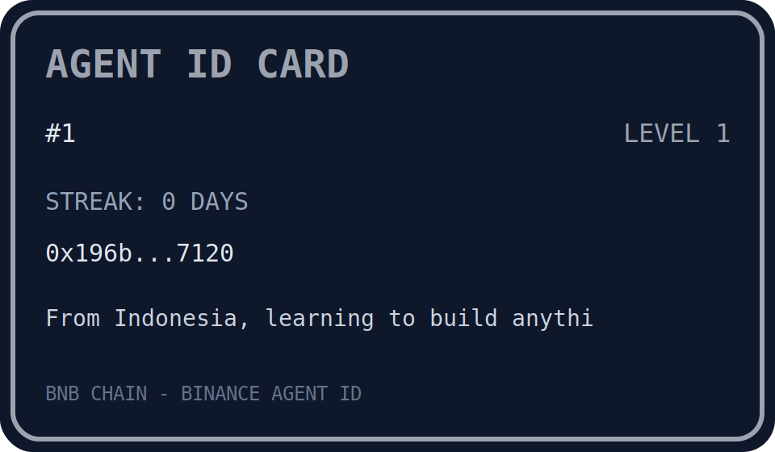

# Agent ID Card

A free, soulbound on-chain reputation card for **Binance Agent ID** holders on BNB Chain. Built for the [Agent ID Hackathon](https://www.binance.com/en/square/post/2123068311714037764) (Binance Wallet + BNB Chain, 18 Nov – 9 Dec 2026).



## What it is

Every Binance Agent ID holder can mint exactly one Agent ID Card — a soulbound ERC-721 whose profile, streak, level and artwork all live entirely on-chain. Holders check in once per UTC day to build a streak and level up from 1 to 5.

- **Free to mint** — no mint fee, no owner, no admin keys, no payable functions. Only gas.
- **Agent ID gated** — minting requires `balanceOf > 0` on the Agent ID contract (`0x60b9262456de011f7d15a54cdd8c48baaa8b022f`), one card per wallet, max supply 1,000.
- **Daily check-in** — one check-in per UTC day; consecutive days raise the streak, gaps reset it. Levels: 3+ days → 2, 7+ → 3, 14+ → 4, 30+ → 5.
- **Fully on-chain** — `tokenURI` returns base64 JSON + SVG rendered from the stored profile (bio, link, streak, level). No external metadata server.
- **Editable profile** — owners can update their bio (≤140 bytes) and link (≤120 bytes) at any time.

## Live

- **Website:** https://agent-id-card.vercel.app
- **Contract (BSC):** [`0x7ca4002127f440E81576179c899e1C3737eFd084`](https://bscscan.com/address/0x7ca4002127f440E81576179c899e1C3737eFd084#code) — verified & open-source on BscScan
- **Traction:** 33 cards minted by 33 distinct Agent ID holders within the first hour of launch (18 Nov 2026)

## How it works

```
mint(bio, link)        — free, requires Agent ID, 1 per wallet
checkIn()              — once per UTC day, builds streak
levelOf(address)       — 1–5 from streak
updateProfile(bio, link)
profileOf(address)     — (bio, link, tokenId, streak, level, lastCheckInDay)
tokenURI(tokenId)      — on-chain JSON + SVG
```

## Development

Built with Foundry (solc 0.8.24, optimizer 200 runs, EVM Cancun). No imports, no owner, no upgradeability.

```bash
forge test    # 25/25 tests pass
```

`standard-input.json` is the exact Standard JSON input used for the BscScan source verification.

## License

MIT
